# System Architecture & Data-Structure Map

## End-to-End Architecture

```mermaid
flowchart LR
    subgraph Data["Static & ML Artifacts (data/)"]
        Cache["graph_cache.txt (4765 nodes, 8156 edges)"]
        RF["demand_rf.txt (Random Forest)"]
        Corridors["corridors.txt (8 TomTom corridors)"]
        EvalFiles["data/eval/summary.json"]
    end

    subgraph Backend["C11 Core & CivetWeb Server (backend/)"]
        DS["Core DS Library\n(LL, Stack, Queue, Tree, Heap, AVL, HashTable)"]
        Routing["Graph + A* / Dijkstra + RouteManager"]
        MLInf["DemandModel + RF Inference + Anomaly"]
        Sim["Fleet Allocator + Discrete-Event Sim + Registry"]
        HTTP["api_app + api_json + CivetWeb (:8080)"]
        Data --> Routing & MLInf & HTTP
        DS --> Routing & Sim
        Routing --> Sim
        MLInf --> Sim
        Sim --> HTTP
    end

    subgraph Frontend["React 19 + TypeScript UI (frontend/)"]
        API["Typed Client + Dev Validators (src/api/)"]
        State["AppStateProvider (1 Hz state / 5 s metrics & routes)"]
        Map["Memoized MapView + 100ms BusLayer + OSM Tiles"]
        Panels["Dashboard | Controls | Demand | DS Explorer | Comparison"]
        HTTP <-->|"HTTP + JSON (/api/*)"| API
        API --> State
        State -->|"Decoupled MapContext"| Map
        State --> Panels
    end
```

## Core Data-Structure Map

| Data Structure | Header | Role in System |
| :--- | :--- | :--- |
| **Doubly Linked List** (`LinkedList`) | `backend/include/linkedlist.h` | Bus completed journey history (`GET /api/bus/:id`), adjacency storage, dynamic sequences |
| **LIFO Stack** (`Stack`) | `backend/include/stack.h` | `RouteManager` ChangeSet undo history stack (`POST /api/undo`, `GET /api/history`, 0 = `TOP`) |
| **Circular FIFO Queue** (`Queue`) | `backend/include/queue.h` | Passenger waiting queues per stop (`FIFO` boarding / aging / censored wait tracking) |
| **General Tree** (`Tree`) | `backend/include/tree.h` | 4-level transit registry hierarchy (`CITY -> DEPOT -> ROUTE -> BUS`, `GET /api/tree`) |
| **Indexed Binary Heap** (`Heap`) | `backend/include/heap.h` | A*/Dijkstra priority frontiers (`O(log V)` decrease-key) & live Route Priority Board (`GET /api/routes`) |
| **Self-Balancing AVL Tree** (`AVL`) | `backend/include/avl.h` | Sorted trip timetable indexed by `(departure_min, trip_id)` (`GET /api/schedule?from=&to=`) |
| **Hash Table** (`HashTable`) | `backend/include/hashtable.h` | Fast stop/node/route ID lookup (`O(1)` average lookup) |
| **Directed Weighted Graph** (`Graph`) | `backend/include/graph.h` | Cached Bengaluru road graph (`4,765` nodes, `8,156` edges) + Tarjan SCC (`graph_scc.h`) |

